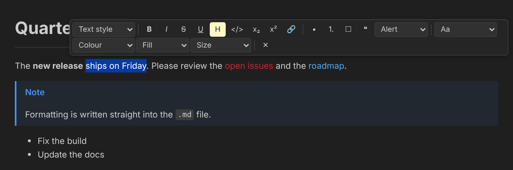
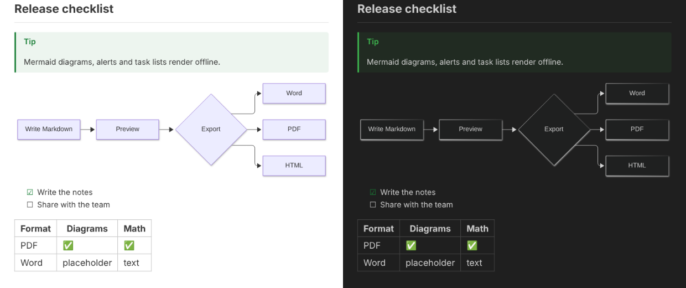

<p align="center">
  
</p>

<h1 align="center">Markdown PreviewEdit</h1>

<p align="center">
  <b>Preview <i>and edit</i> Markdown in VS Code: diagrams, alerts, formatting straight from the preview, and export to Word, PDF and HTML.</b><br>
  Free, open source, offline, no telemetry.
</p>

<p align="center">
  <a href="https://github.com/adhunna/markdown-previewedit/actions/workflows/ci.yml"></a>
  <a href="https://github.com/adhunna/markdown-previewedit/releases"></a>
  <a href="LICENSE"></a>
</p>

<p align="center">
  
</p>

Markdown PreviewEdit builds on **VS Code's own Markdown preview** instead of replacing it, so live update, scroll sync, math and your theme keep working. It adds what's missing:

- 🧜 **Mermaid diagrams**, **GitHub alerts**, task lists, a table of contents, footnotes and more
- ✏️ **Format from the preview:** select text and make it a title, bold, a list, red, bigger… The change is written into your `.md` file.
- 📄 **Export to Word, PDF and HTML.** Word files use real Word styles, and PDFs are printed by the Edge already on your PC.
- 🌗 **Light/Dark switch, zoom and full screen** for the preview, whatever your VS Code theme
- 🔒 **Safe with untrusted files:** everything is bundled, nothing is downloaded, and nothing in a document can run code

> **Status:** 0.3.0 pre-release. Install it from a [GitHub Release](https://github.com/adhunna/markdown-previewedit/releases); it is not on the VS Code Marketplace yet.

## Install

1. Download `markdown-previewedit-<version>.vsix` from the latest [GitHub Release](https://github.com/adhunna/markdown-previewedit/releases).
2. In VS Code, open the **Extensions** view (`Ctrl+Shift+X`), click the **`…`** menu at the top right of the view, choose **Install from VSIX…** and pick the file.
3. Reload VS Code if it asks.

You need VS Code 1.95 or newer on Windows, macOS or Linux. PDF export also needs Microsoft Edge, Google Chrome or Chromium.

## Quick start

1. Open any `.md` file. You can try [`samples/features/all.md`](samples/features/all.md), which uses every feature.
2. Click **Open Preview to the Side** (top right). In the preview, use the zoom, colour-mode and full-screen buttons.
3. Click the **pencil** button instead to open the **Edit Preview**, then select some text and use the toolbar.
4. Right-click in the file → **PreviewEdit: Export** → Word, PDF or HTML.

Everything is explained in the **[user guide](docs/user-guide.md)**: all buttons, commands, shortcuts, settings and syntax.

## What it looks like

<p align="center">
  
</p>

| Extra syntax | Write |
|---|---|
| Mermaid diagram | ```` ```mermaid ```` |
| GitHub alert | `> [!NOTE]`, `[!TIP]`, `[!IMPORTANT]`, `[!WARNING]`, `[!CAUTION]` |
| Box / collapsible | `::: warning Title` … `:::` · `::: details Summary` … `:::` |
| Table of contents | `[TOC]` |
| Task list | `- [ ]` / `- [x]` |
| Footnotes, definitions, abbreviations | `[^1]`, `Term` + `: Definition`, `*[HTML]: …` |
| Highlight, inserted, sub/superscript, emoji | `==mark==`, `++ins++`, `H~2~O`, `x^2^`, `:tada:` |

*Screenshots are rendered outside VS Code; in VS Code the preview uses your theme's fonts and colours.*

## Privacy and security

- No telemetry and no network access: Mermaid, KaTeX and everything else are bundled.
- Works inside VS Code's preview security and never asks you to loosen it.
- Exported HTML is sanitized. Scripts, frames, forms, event handlers and `javascript:` links are removed, and the only CSS kept is text colour, background colour and font size.
- The Edit Preview accepts only a fixed set of checked messages and edits nothing but its own document.
- PDF export starts your local browser, so it is off in untrusted (Restricted Mode) workspaces.
- A set of hostile Markdown files ([`samples/malicious/`](samples/malicious/)) is tested on every build.

Found a vulnerability? Please report it privately; see [SECURITY.md](SECURITY.md).

## Roadmap

130 catalogued features, from the original market research, are tracked in [ROADMAP.md](ROADMAP.md). Coming next:
- a Word reference template
- **copy as rich text** for Outlook and Teams
- smart paste from Word and Excel
- images and diagrams in Word
- diagram styling from the preview
- Graphviz, file imports and custom CSS

## Contributing

Bug reports, ideas, documentation and code are all welcome. Start with **[CONTRIBUTING.md](CONTRIBUTING.md)** and the [architecture guide](docs/architecture.md). Everyone taking part follows the [Code of Conduct](CODE_OF_CONDUCT.md).

```powershell
git clone https://github.com/adhunna/markdown-previewedit.git
cd markdown-previewedit
npm ci
npm test          # unit, export and security tests
npm run package   # → markdown-previewedit-<version>.vsix
```

Press **F5** in VS Code to try your changes in a development window. All project documents are listed in [docs/README.md](docs/README.md).

## Acknowledgements

Built on [VS Code's Markdown preview](https://github.com/microsoft/vscode/tree/main/extensions/markdown-language-features), [markdown-it](https://github.com/markdown-it/markdown-it), [Mermaid](https://mermaid.js.org/), [KaTeX](https://katex.org/), [docx](https://github.com/dolanmiu/docx), [puppeteer-core](https://pptr.dev/) and [sanitize-html](https://github.com/apostrophecms/sanitize-html). Every bundled package and its licence is listed in [THIRD_PARTY_NOTICES.md](THIRD_PARTY_NOTICES.md).

Inspired by [Markdown Preview Enhanced](https://github.com/shd101wyy/vscode-markdown-preview-enhanced); no code is shared.

## Licence

[MIT](LICENSE) © The Markdown PreviewEdit contributors
