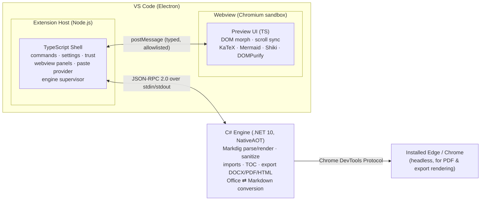
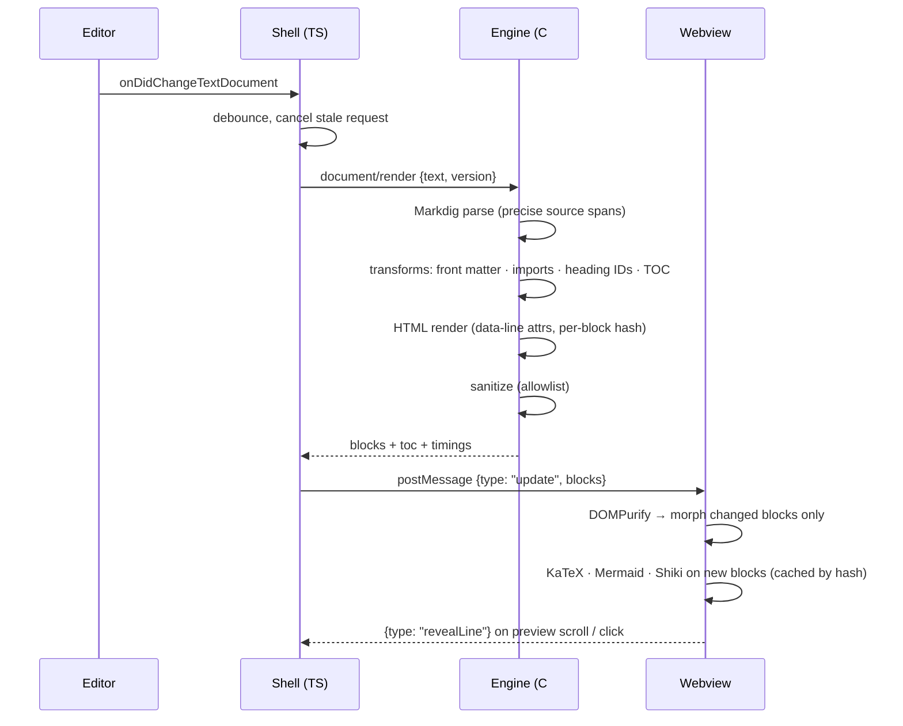
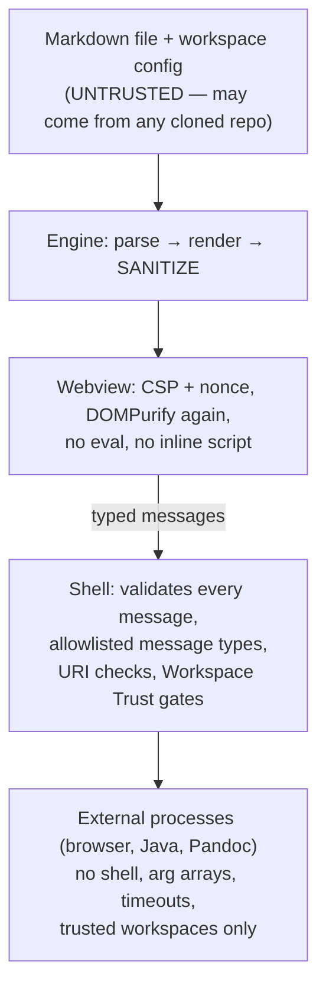

# 03 — Architecture

> **Name:** this project was called *MarkDownPreview* (command prefix `mdp.`) when this document was written. It is now **Markdown PreviewEdit** (prefix `previewEdit.`); see decision D1 in [04-implementation-plan.md](04-implementation-plan.md).

> **Current stack:** superseded for the MVP by [ADR-001](adr/001-stack-typescript-builtin-preview.md) — a TypeScript extension on VS Code's built-in preview. This C#/.NET design is kept as the long-term option (e.g. for a richer Word engine or own webview).

> **Purpose:** How a C#/.NET-first Markdown preview runs inside VS Code, which code goes where, and the key technical decisions.
> **Status:** Proposed. Decisions marked *Proposed* are confirmed (or changed) by the Phase 0 spikes in [04-implementation-plan.md](04-implementation-plan.md).

---

## 1. The big picture

VS Code extensions must start from JavaScript in the **Extension Host** (Node.js), and previews are **webviews** (sandboxed Chromium pages). We keep both of those layers thin and put the real work in a **C# engine process**.



| Layer | Language | Share of code (target) | Responsibilities |
|---|---|---|---|
| **Engine** | C# 14 / .NET 10 | **75–85 %** | Parse (Markdig), transform (front matter, imports, IDs, TOC), render HTML with source-line map and block hashes, sanitize, export (DOCX via Open XML SDK, PDF/HTML via headless browser), HTML/DOCX/Excel → Markdown, workspace index (later) |
| **Shell** | TypeScript | 10–15 % | Activation, commands, keybindings, settings, Workspace Trust, webview lifecycle, engine process supervision, paste-edit provider, Language Model Tools registration |
| **Webview** | TypeScript (browser) | 5–10 % | Apply HTML updates (DOM morph), scroll sync, run JS-only renderers (KaTeX, Mermaid, Shiki, Graphviz-WASM), context menu, TOC sidebar |

### Rule of thumb — where does new code go?

1. Does it need the **VS Code API** (commands, editors, settings, clipboard paste, trust)? → **Shell**.
2. Does it need the **DOM** or a **JavaScript-only library** (Mermaid, KaTeX, Shiki)? → **Webview**.
3. **Everything else** → **Engine (C#)**. When unsure, it goes in the engine.

---

## 2. Hosting & packaging the C# engine (Decision ADR-001, *Proposed*)

| Option | How it works | Pros | Cons | Verdict |
|---|---|---|---|---|
| **A. NativeAOT binary per platform** | `dotnet publish -r <rid> -p:PublishAot=true`; binary placed in `bin/` of a **platform-specific VSIX** (`vsce package --target win32-x64` …) | No .NET install for users; fast start (tens of ms); small; same model VS Code uses for ripgrep | 9 targets to build (`win32-x64/arm64`, `linux-x64/arm64/armhf`, `alpine-x64/arm64`, `darwin-x64/arm64`); every library must be trim/AOT-safe | **Recommended for releases** |
| **B. Framework-dependent DLL + .NET Install Tool** | `extensionDependencies: ["ms-dotnettools.vscode-dotnet-runtime"]`, call `dotnet.acquire` for `10.0`, run `dotnet Engine.dll` | One universal VSIX; no AOT limits; same pattern as C# Dev Kit | First-run runtime download; depends on another extension; slower start (JIT) | **Use for development** and as the **universal fallback VSIX** (K08) |
| **C. .NET WebAssembly** | `browser-wasm` build, `[JSExport]` API, loaded in the extension host or a web worker | Runs in vscode.dev; no native binaries | Larger startup cost, slower; no process/browser for PDF | **Phase 5** for VS Code for the Web (K09) |
| D. Self-contained (non-AOT) per platform | `--self-contained` publish | No AOT limits | 60–80 MB per platform | Not recommended |

**Rules that follow from this decision:** the engine is written **AOT-safe from day one** — `IsAotCompatible=true`, trim/AOT warnings are errors, System.Text.Json **source generation** only, no runtime reflection or `dynamic`.

`extensionKind: ["workspace"]` — in Remote-SSH/WSL/Containers the shell *and* engine run on the machine that has the files.

---

## 3. Shell ⇄ Engine protocol (ADR-002, *Proposed*)

- **Transport:** JSON-RPC 2.0 over the engine's stdin/stdout with LSP-style `Content-Length` framing. Logs go to **stderr** only.
- **Libraries:** `vscode-jsonrpc` (shell) ⇄ `StreamJsonRpc` with `SystemTextJsonFormatter` + source-generated contracts (engine). StreamJsonRpc documents itself as "partially NativeAOT-safe"; Phase 0 spike S1 verifies this. **Fallback:** a small hand-written JSON-RPC loop on `System.Text.Json` source generators.
- **Contract-first:** request/response types are C# `record`s in `MarkDownPreview.Protocol`. A build step exports **JSON Schema** (`System.Text.Json.Schema.JsonSchemaExporter`) and generates the **TypeScript types** for the shell. Nobody hand-edits the generated TS.
- **Versioning:** `initialize` exchanges `protocolVersion`; the shell refuses mismatched engines with a clear error.

Draft methods (names may change in Phase 0):

| Direction | Method | Purpose |
|---|---|---|
| S → E | `initialize` / `shutdown` / `exit` | Handshake (versions, settings, workspace roots, `isTrusted`) and clean stop |
| S → E | `document/render` | `{uri, version, text, options}` → `{blocks[{id, hash, html, lineStart, lineEnd}], toc, frontMatter, assets, diagnostics, timings}` |
| S → E | `export/run` | `{uri, format: html\|pdf\|docx\|…, options}` → `{outputPath}`; streams `$/progress`; supports `$/cancelRequest` |
| S → E | `convert/htmlToMarkdown` | Smart paste (F01/F02) |
| S → E | `convert/docxToMarkdown` | DOCX import (F03) |
| S → E | `settings/changed`, `workspace/trustChanged` | Configuration and trust updates |
| E → S | `workspace/readFile` | Read non-`file:` URIs (virtual / remote file systems) through VS Code |
| E → S | `window/log` | Structured logs into the output channel |

---

## 4. Render pipeline (preview)



Key points:

- **Block hashes** let the webview replace only changed blocks, so diagrams and scroll position stay put (A05).
- **Source-line map** (`data-line-start/end` on every block element) drives two-way scroll sync (A06/A07).
- **JS-only renderers** (KaTeX, Mermaid, Shiki, Graphviz-WASM) run in the webview; results are cached by content hash (C03).

## 5. Render host for exports (ADR-004, *Proposed*)

Exports need the *finished* rendering, including Mermaid SVGs, KaTeX output and highlighted code, which only a browser can produce.

- The engine builds a self-contained HTML document (same renderer as the preview, export theme, no VS Code variables).
- It opens that document in **headless Microsoft Edge / Chrome already installed on the machine** via the Chrome DevTools Protocol (PuppeteerSharp; verified for AOT in spike S3), waits for a "render complete" signal, then:
  - **PDF:** `Page.printToPDF` with margins, header/footer templates (E02/E03).
  - **HTML:** serialises the final DOM (diagrams as inline SVG) (E01).
  - **DOCX:** collects diagram images (SVG + PNG), MathML for equations and highlighted-code spans, then builds the Word file with the **Open XML SDK** (E04–E08).
- Browser discovery order: setting `mdp.export.browserPath` → Edge → Chrome → Chromium. If none is found, the user is offered an opt-in download (Chrome for Testing).

## 6. Security model (ADR-005, *Proposed*)



| Trust boundary | Control |
|---|---|
| Markdown → HTML | Engine sanitizer (allowlist of tags/attributes/URL schemes) **and** DOMPurify in webview |
| Webview → Shell | Message types are an explicit allowlist with schema validation; a webview can never name a command to run or a file to write |
| Webview resources | CSP: `default-src 'none'`; scripts only with the per-load nonce; `'wasm-unsafe-eval'` allowed only for bundled WASM (Graphviz); **never** `'unsafe-eval'`; `localResourceRoots` limited |
| Workspace content | **Restricted Mode** (untrusted workspace): no raw-HTML scripts, no custom head, no imports outside the workspace, no external tools, no code chunks |
| Configuration | Declarative JSON only (`.mdp/config.json`). No executable config files, ever |
| Processes | `Process.Start` with `UseShellExecute=false` and `ArgumentList`; paths validated; timeouts; kill on cancel |
| Network | Off by default; Kroki/PlantUML-server/remote images are opt-in and labelled |

## 7. Performance budgets (verified in Phase 0, enforced in CI from Phase 1)

| Metric | Budget |
|---|---|
| Extension activation (engine starts lazily on first preview) | < 50 ms |
| Engine cold start to "ready" (NativeAOT, Windows x64) | < 150 ms |
| Engine render, 100 KB Markdown | < 30 ms |
| Engine render, 1 MB Markdown | < 250 ms |
| Keystroke → preview painted (50 KB doc, after debounce, no diagrams) | < 100 ms p95 |
| Engine memory with 10 open previews | < 200 MB |
| VSIX size per platform | < 30 MB |

## 8. Technology stack (versions checked 2026-10-12)

| Concern | Choice | Version | Licence |
|---|---|---|---|
| Runtime | .NET (LTS, supported to Nov 2028) | 10.0 | MIT |
| Markdown parser | Markdig | 1.4.0 | BSD-2-Clause |
| Front matter | YamlDotNet (static/source-generated context for AOT) | 18.1.0 | MIT |
| HTML sanitizer | HtmlSanitizer (AngleSharp) | 9.2.x (AngleSharp 1.8.x) | MIT |
| Word/Excel/PowerPoint | DocumentFormat.OpenXml (Open XML SDK) | 3.5.1 | MIT |
| HTML → Markdown | ReverseMarkdown | 6.2.1 | MIT |
| Headless browser control | PuppeteerSharp (CDP; uses installed Edge/Chrome) | 25.x | MIT |
| JSON-RPC (engine) | StreamJsonRpc + SystemTextJsonFormatter | 2.25.x | MIT |
| JSON-RPC (shell) | vscode-jsonrpc | 9.0.x | MIT |
| Shell build | TypeScript (strict) + esbuild; `@types/vscode` pinned to `engines.vscode` | — | — |
| Packaging | @vscode/vsce, ovsx | 4.0.0, 1.2.0 | MIT / EPL-2.0 |
| Webview libs | Mermaid, KaTeX, Shiki (JS regex engine, no WASM), DOMPurify, idiomorph/morphdom | 12.1.0, 0.19.0, 4.5.0, 3.4.x | MIT / Apache-2.0 |
| Engine tests | xUnit v3, Verify (snapshots), BenchmarkDotNet | latest | MIT |
| Extension tests | @vscode/test-cli + @vscode/test-electron; Playwright for webview | latest | MIT |

Versions are **starting points**; Phase 0 pins exact versions in `Directory.Packages.props` and `package-lock.json`.

## 9. Repository layout (target)

```
/AGENTS.md                  rules for AI coding agents
/README.md
/docs/                      research, features, architecture, plan, adr/
/samples/                   Markdown test documents (feature demos + malicious corpus)
/src/engine/                C# — MarkDownPreview.sln
  MarkDownPreview.Protocol/   request/response records (source of truth for the protocol)
  MarkDownPreview.Core/       parse, transform, render, sanitize, source map
  MarkDownPreview.Export/     HTML, PDF (render host), DOCX
  MarkDownPreview.Interop/    HTML/DOCX/Excel → Markdown
  MarkDownPreview.Host/       console app: JSON-RPC server (NativeAOT entry point)
/src/engine.tests/          xUnit v3 test projects + benchmarks
/src/extension/             TypeScript shell (package.json, esbuild, tests)
/src/webview/               browser-side TypeScript (esbuild bundle)
/.github/workflows/         ci.yml, release.yml
```

## 10. Decision records (to be written as `docs/adr/NNN-*.md` in Phase 0)

| ADR | Decision | Status |
|---|---|---|
| 001 | Engine hosting: NativeAOT per platform for release; framework-dependent + .NET Install Tool for dev and universal fallback | Proposed |
| 002 | Protocol: JSON-RPC 2.0 over stdio; contract-first C# records → JSON Schema → generated TS | Proposed |
| 003 | Syntax highlighting: Shiki in webview (exact VS Code colours); exports reuse its output via the render host | Proposed |
| 004 | Render host: headless installed Edge/Chrome via CDP for PDF/HTML/DOCX assets | Proposed |
| 005 | Security model as in §6 | Proposed |
| 006 | Webview UI: framework-free TypeScript (small bundle, simple CSP) | Proposed |
