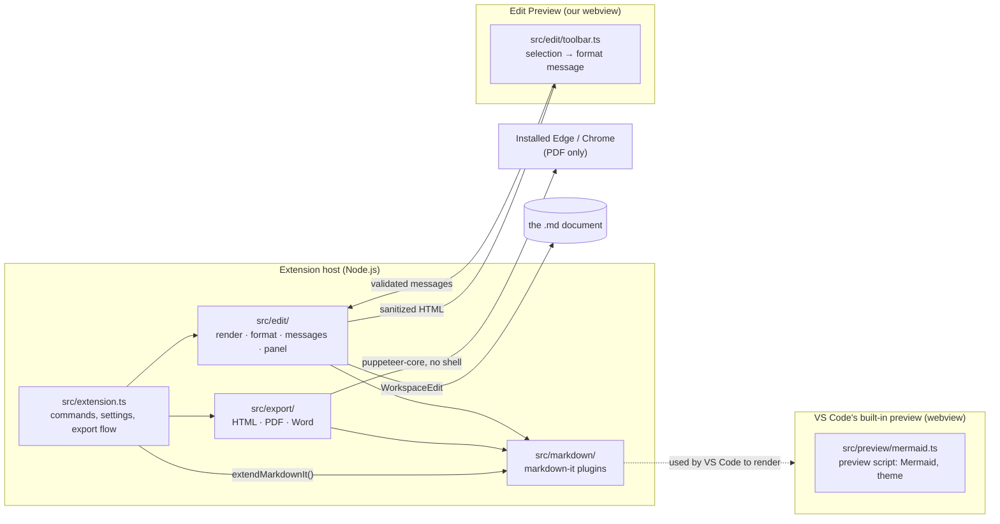

# Architecture

How Markdown PreviewEdit is built today. This is for contributors; users want the [user guide](user-guide.md).

The decisions behind this design are recorded in [ADR-001](adr/001-stack-typescript-builtin-preview.md) (TypeScript on top of VS Code's built-in preview) and [ADR-002](adr/002-edit-preview-webview.md) (our own Edit Preview webview). The C#/.NET design in [03-architecture.md](03-architecture.md) is a possible future, not the current code.

## The big picture



Four ideas carry the whole design:

1. **One set of markdown-it plugins** (`src/markdown/`) is used everywhere: the built-in preview, the Edit Preview and every exporter. New syntax is added once and shows up in all of them.
2. **We extend VS Code's preview; we don't replace it.** VS Code provides live update, scroll sync, math, theming, CSP and link handling. We add plugins, one preview script and one stylesheet through `package.json` (`markdown.markdownItPlugins`, `markdown.previewScripts`, `markdown.previewStyles`).
3. **Exports run in the extension host** and pass through an allowlist sanitizer, because the files leave VS Code's sandbox.
4. **The Edit Preview is a separate webview.** VS Code's preview cannot send messages to extensions. Ours sends a small, validated set, and every change becomes an ordinary undoable edit.

## Module map

| Path | Role | Uses VS Code API? |
|---|---|---|
| `src/extension.ts` | Activation; registers commands, buttons and settings listeners; export flow (save dialog, progress, open file); returns `extendMarkdownIt` to VS Code | yes |
| `src/markdown/plugins.ts` | `extendMarkdownIt(md, options)`: the one place plugins are registered | no |
| `src/markdown/containers.ts`, `tasklists.ts`, `toc.ts`, `mermaid.ts` | Our own syntax plugins (`:::` boxes, task lists, `[TOC]`, Mermaid placeholders) | no |
| `src/markdown/previewTheme.ts` | Emits a hidden marker carrying the forced Light/Dark theme | no |
| `src/markdown/sourceMap.ts` | Edit Preview only: source lines on blocks, source offsets on every text character | no |
| `src/markdown/styles.ts` | The only CSS allowed in documents (colour, background, font size) plus conversions for Word | no |
| `src/markdown/util.ts`, `slug.ts` | Escaping, scroll-sync attributes, heading slugs | no |
| `src/preview/mermaid.ts` | Preview script for the built-in preview (also embedded in HTML/PDF exports): renders Mermaid and applies the forced theme | browser |
| `src/export/engine.ts` | markdown-it for exports: plugins + KaTeX + **sanitizer** | no |
| `src/export/html.ts` | Self-contained HTML page (inlined CSS and fonts) | no |
| `src/export/pdf.ts`, `browser.ts` | PDF through the installed Edge/Chrome; request filter; browser discovery | no |
| `src/export/docx.ts` | markdown-it tokens → native Word document (`docx` library) | no |
| `src/edit/render.ts` | Edit Preview HTML = export engine + source map | no |
| `src/edit/format.ts` | Formatting choice → text edits (pure, heavily tested) | no |
| `src/edit/messages.ts` | Allowlist and validation of every webview message | no |
| `src/edit/panel.ts` | The Edit Preview webview: CSP, rendering, applying edits | yes |
| `src/edit/toolbar.ts` | Edit Preview script: toolbar, selection → source offsets | browser |
| `src/preview-settings.ts`, `src/full-screen.ts` | Pure helpers for font size, theme cycling and full-screen layout commands | no |
| `media/` | Stylesheets (preview, export, Edit Preview) and the extension icon | — |
| `esbuild.mjs` | Builds `dist/extension.js` (Node), `dist/preview/mermaid.js` and `dist/edit/toolbar.js` (browser), and `dist/katex-inline.css` | — |

Names: commands, settings and the context key use the `previewEdit.` prefix (user-visible). CSS classes and DOM attributes use the short internal prefix `mdp-` (`mdp-mermaid`, `data-mdp-theme`), which users never see.

Keeping `src/markdown/`, `src/export/` and `src/edit/` free of `import 'vscode'` (except `panel.ts`) is what makes almost everything unit-testable with plain Node.

## How a formatting click becomes an edit

```mermaid
sequenceDiagram
  participant U as User
  participant T as toolbar.ts (webview)
  participant P as panel.ts (extension)
  participant F as format.ts
  participant D as Document
  P->>T: update {html, version}
  U->>T: selects "brave", clicks B
  T->>T: map DOM selection → source offsets via data-src spans
  T->>P: format {version, request}
  P->>P: parseWebviewMessage() — allowlist + bounds + version check
  P->>F: applyFormat(source, request)
  F-->>P: edits [{6,6,"**"}, {11,11,"**"}] + new selection
  P->>D: WorkspaceEdit (undoable; CRLF kept)
  D-->>P: onDidChangeTextDocument
  P->>T: update {html, version+1, select}
```

The source map is what makes this exact. `sourceMap.ts` wraps every piece of rendered text in `<span data-src="OFFSET">`, including characters written as escapes (`\*`) or entities (`&amp;`). A test checks, for the whole feature tour, that every traced character matches the source at its offset.

## Security boundaries

| Boundary | Protection |
|---|---|
| Markdown → built-in preview | VS Code's CSP and sanitizer; we only add markdown-it renderers that escape text |
| Markdown → exported HTML/PDF | `sanitize-html` allowlist plus an inline-tag allowlist (`src/export/engine.ts`); only safe `<span style>` CSS survives |
| PDF browser | Started by puppeteer-core without a shell; requests limited to `file:`, `data:` and web images; disabled in Restricted Mode |
| Edit Preview webview → extension | Fixed message list, every field validated (`src/edit/messages.ts`); edits refused for a stale document version |
| Edit Preview page | CSP `default-src 'none'`, scripts by nonce only; content is the sanitized export HTML; toolbar built with DOM APIs |
| Diagrams | Mermaid `securityLevel: 'strict'`; errors shown with `textContent` |

The hostile files in [`samples/malicious/`](../samples/malicious/) are rendered by every pipeline in `test/security.test.ts`.

## Where to change things

| You want to… | Do this |
|---|---|
| Add Markdown syntax | Write a markdown-it plugin in `src/markdown/`, register it in `plugins.ts`, and map its tokens in `docx.ts`. Add it to `samples/features/all.md` and assert it in `test/render.test.ts` (and `test/docx.test.ts`). |
| Add a toolbar action | Add the action type and its edit logic to `format.ts` (with table tests in `test/format.test.ts`) and its validation to `messages.ts` (tests in `test/messages.test.ts`). Then add the button in `toolbar.ts`. Changing the message list needs the owner's agreement. |
| Change export output | `src/export/`; check real output by exporting the feature tour (see the testing rules in [AGENTS.md](../AGENTS.md#7-testing-rules)) |
| Add a command or setting | `package.json` `contributes` + `src/extension.ts`; document it in the [user guide](user-guide.md). New settings and commands need the owner's agreement first. |

## Tests

`npm test` bundles `test/*.test.ts` with esbuild and runs them with Node's built-in test runner.

- **No VS Code needed:** the unit, export and security tests.
- **Need Edge, Chrome or Chromium:** the PDF, preview-theme and toolbar tests. They are skipped if no browser is found; set `MDP_TEST_BROWSER` to point at one.
