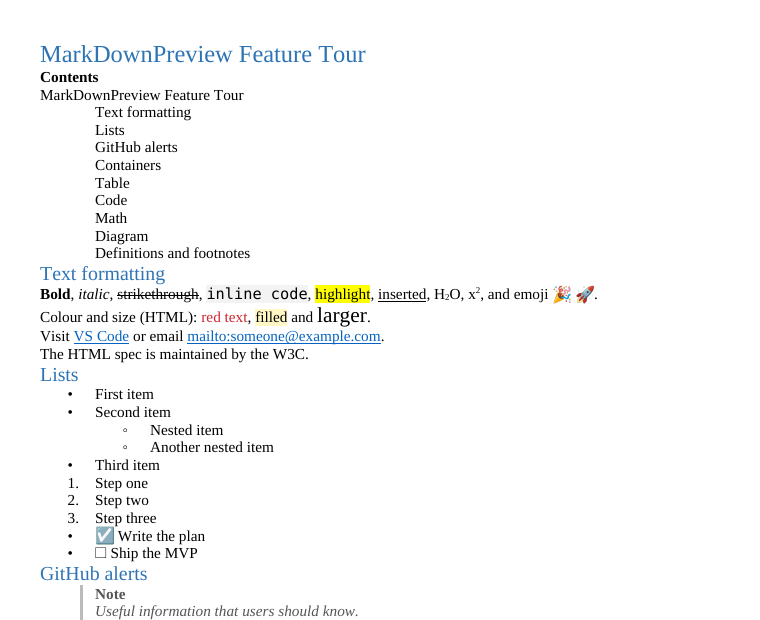

# User guide

Everything Markdown PreviewEdit adds to VS Code, in one place. For installation see the [README](../README.md#install).

- [Opening the preview](#opening-the-preview)
- [Preview buttons: size, theme, full screen](#preview-buttons-size-theme-full-screen)
- [Format from the preview (Edit Preview)](#format-from-the-preview-edit-preview)
- [Extra Markdown syntax](#extra-markdown-syntax)
- [Export to Word, PDF and HTML](#export-to-word-pdf-and-html)
- [Commands and keyboard shortcuts](#commands-and-keyboard-shortcuts)
- [Settings](#settings)
- [Untrusted workspaces](#untrusted-workspaces)
- [Troubleshooting](#troubleshooting)

---

## Opening the preview

Markdown PreviewEdit extends **VS Code's own Markdown preview**, so everything you know still works.

| How | Result |
|---|---|
| **Open Full Preview** button (top right of a `.md` file, single-page icon) | Preview in the same tab, full width |
| **Open Split Preview** button (next to it, split icon) | Preview beside the file |
| **Open Edit Preview** button (pencil) | Edit Preview beside the file (see below) |
| `Ctrl+Shift+V` / `Ctrl+K V` | VS Code's own shortcuts: same tab / to the side |

> **Seeing two split-preview icons?** One is VS Code's own *Open Preview to the Side*. Right-click the title bar of the `.md` file and untick **Open Preview to the Side** to hide it; PreviewEdit's **Open Split Preview** does the same thing.

The preview updates as you type and scrolls with the editor. Double-click the preview to jump to that line in the source. `Ctrl+F` searches inside it.

## Preview buttons: size, theme, full screen

When the preview tab is active, its title bar (top right) shows:

| Button | Shortcut (click in the preview first) | What it does |
|---|---|---|
| Zoom out / Zoom in | `Ctrl+-` / `Ctrl+=` | Text size one pixel smaller / larger (8–40 px) |
| — | `Ctrl+0` | Back to the default size (14 px) |
| Colour mode (half circle) | — | Cycles **Auto** (follow VS Code) → **Light** → **Dark** |
| Full screen (four corners) | — | Fills the VS Code window with the preview: other editors, both side bars and the panel are hidden. Click again to restore. |

- The text size is VS Code's own `markdown.preview.fontSize` setting, saved in your User settings.
- The shortcuts only work while the preview has focus. Elsewhere `Ctrl+=` / `Ctrl+-` still zoom the whole window as usual.
- After leaving full screen, reopen the bottom panel with `Ctrl+J` if you had it open.

## Format from the preview (Edit Preview)


*Illustration rendered outside VS Code; the real panel uses your VS Code theme.*

To open it:
- click the **pencil button** next to the preview button on a Markdown file,
- right-click in the editor → **PreviewEdit: Open Edit Preview**, or
- run **PreviewEdit: Open Edit Preview** from the Command Palette.

The Edit Preview opens beside the file. Select text in it and a toolbar appears above the selection:

| Control | What it writes into the `.md` file |
|---|---|
| **Text style** | Normal text, Title (`# `), Heading 2–6 (`## ` … `###### `) |
| **B** / *I* / S / U / H | `**bold**`, `*italic*`, `~~strikethrough~~`, `++underline++`, `==highlight==` |
| `</>` / x₂ / x² | `` `code` ``, `~subscript~`, `^superscript^` |
| 🔗 | `[text](address)`. Asks for the address; leave it empty to remove a link. Only `http(s):`, `mailto:`, `#heading` and relative links are accepted. |
| • / 1. / ☐ | Bulleted, numbered or task list (click again to remove) |
| ❝ / Alert | Quote; GitHub alert: Note, Tip, Important, Warning, Caution |
| **Aa** | UPPERCASE, lowercase, Title Case, Sentence case (links and code stay untouched) |
| **Colour / Fill / Size** | `<span style="color:…">`, `background-color`, `font-size`. See [Colours and sizes are HTML](#colours-and-sizes-are-html) below. |
| ✕ | Clear formatting: removes marks, colour spans and links, keeps the text |

Good to know:

- **Toggles:** a button shows as pressed when the selection already has that format; clicking it removes the format.
- **Shortcuts:** `Ctrl+B` and `Ctrl+I` work while text is selected. `Esc` hides the toolbar.
- **Undo:** every change is an ordinary edit. Undo it with `Ctrl+Z` in the editor. Nothing is saved until you save the file.
- **Typing:** you still type text in the editor. The Edit Preview formats; it is not a word processor.
- **Not formattable:** text that VS Code generates cannot be formatted from the preview. That covers table-of-contents entries, emoji written as `:shortcodes:` and math.
- **Navigation:** double-click to jump to the source line. Links are not followed inside the Edit Preview.

### Colours and sizes are HTML

Markdown has no colours or text sizes, so the toolbar writes a small piece of HTML:

```markdown
Please review the <span style="color:#d1242f">open issues</span>.
```

These colours and sizes appear in:
- both previews, and
- Word, PDF and HTML exports.

They do **not** show on GitHub, which removes `style` attributes. For portable files, prefer bold, highlight (`==text==`) or alerts.

Only three properties are ever kept, with plain values: `color`, `background-color` and `font-size` (50–300 %). Anything else in a `style` attribute is removed.

## Extra Markdown syntax

On top of CommonMark and what VS Code already renders (math, front matter, tables, strikethrough, autolinks):

| Feature | Syntax |
|---|---|
| Mermaid diagrams (offline; follow the theme; a clear error box if a diagram is broken) | ```` ```mermaid ```` |
| GitHub alerts | `> [!NOTE]`, `> [!TIP]`, `> [!IMPORTANT]`, `> [!WARNING]`, `> [!CAUTION]` |
| Boxes and collapsible sections | `::: warning Title` … `:::`; `::: details Summary` … `:::` (also `note`, `tip`, `info`, `danger`) |
| Table of contents | `[TOC]` or `<!-- toc -->` on its own line |
| Task lists | `- [ ] to do` / `- [x] done` |
| Footnotes | `Text[^1]` and `[^1]: Note` |
| Definition lists | `Term` then `: Definition` on the next line |
| Abbreviations | `*[HTML]: HyperText Markup Language` |
| Highlight, inserted | `==mark==`, `++inserted++` |
| Subscript, superscript | `H~2~O`, `x^2^` |
| Emoji | `:tada:` |
| Colour and size (HTML) | `<span style="color:#0969da; font-size:1.25em">text</span>` |

[`samples/features/all.md`](../samples/features/all.md) uses all of them. Open it to see everything at once.

## Export to Word, PDF and HTML

Right-click in a Markdown file → **PreviewEdit: Export**, or use the Command Palette:

| Command | Result |
|---|---|
| **PreviewEdit: Export to Word (.docx)** | A native Word document with real Heading, list, table, quote and code styles. Colours and sizes are kept. *Images, diagrams and equations are placeholders in this version.* |
| **PreviewEdit: Export to PDF** | Printed by the **Microsoft Edge** already on your PC (or Chrome/Chromium). Nothing is downloaded. Includes diagrams and math. |
| **PreviewEdit: Export to HTML** | One self-contained page that works offline, with diagrams and math |



*The feature tour exported to Word, shown here in LibreOffice.*

- Exports always use a light, print-friendly style, whatever the preview theme.
- The document title comes from `title:` in the front matter, or else the first heading.
- After exporting, the file opens in its default application. Turn this off with `previewEdit.export.openAfterExport`.

## Commands and keyboard shortcuts

All commands are in the Command Palette (`Ctrl+Shift+P`) under **PreviewEdit**.

| Command | Shortcut | Where the button is |
|---|---|---|
| PreviewEdit: Open Full Preview | VS Code: `Ctrl+Shift+V` | Title bar of a `.md` file |
| PreviewEdit: Open Split Preview | VS Code: `Ctrl+K V` | Title bar of a `.md` file |
| PreviewEdit: Open Edit Preview (format from preview) | — | Title bar of a `.md` file (pencil); editor right-click menu |
| PreviewEdit: Increase Preview Font Size | `Ctrl+=` (preview focused) | Preview title bar |
| PreviewEdit: Decrease Preview Font Size | `Ctrl+-` (preview focused) | Preview title bar |
| PreviewEdit: Reset Preview Font Size | `Ctrl+0` (preview focused) | — |
| PreviewEdit: Toggle Preview Theme (Auto / Light / Dark) | — | Preview title bar |
| PreviewEdit: Toggle Full-Screen Preview | — | Preview title bar |
| PreviewEdit: Export to Word (.docx) / PDF / HTML | — | Editor right-click menu → **PreviewEdit: Export** |

To change a shortcut: **File → Preferences → Keyboard Shortcuts**, search for "PreviewEdit".

## Settings

**File → Preferences → Settings** (`Ctrl+,`), search for "mdp".

| Setting | Default | Meaning |
|---|---|---|
| `previewEdit.preview.theme` | `auto` | Preview colours: `auto` (follow VS Code), `light`, `dark` |
| `markdown.preview.fontSize` | `14` | VS Code's own preview text size, changed by the zoom buttons |
| `previewEdit.mermaid.enabled` | `true` | Render Mermaid code blocks as diagrams |
| `previewEdit.export.openAfterExport` | `true` | Open the exported file when done |
| `previewEdit.export.browserPath` | *(empty: detect)* | Edge/Chrome/Chromium used for PDF export, if not found automatically |
| `previewEdit.export.pdf.format` | `A4` | Paper size: A4, A3, A5, Letter, Legal |
| `previewEdit.export.pdf.margin` | `20mm` | Page margin (any CSS length, e.g. `0.75in`) |

## Untrusted workspaces

In VS Code's **Restricted Mode** (a folder you have not trusted):

- The previews, the Edit Preview, and Word and HTML export work normally. Content is sanitized either way.
- **PDF export is off**, because it starts a local browser. Trust the folder to use it.
- `previewEdit.export.browserPath` from the workspace settings is ignored.

## Troubleshooting

| Problem | What to do |
|---|---|
| "PDF export needs Microsoft Edge, Google Chrome or Chromium" | Install one, or set `previewEdit.export.browserPath` to its `.exe`, e.g. `C:\Program Files (x86)\Microsoft\Edge\Application\msedge.exe` |
| A diagram shows a red error box | The Mermaid code has a syntax error; the box shows Mermaid's message |
| The toolbar does not appear | Select text that comes from the file. Generated text (TOC entries, emoji shortcodes, math) can't be formatted. |
| "The document changed while you were selecting" | The file changed after the preview was drawn (e.g. you were typing). Select the text again. |
| Something else | **View → Output**, choose **Markdown PreviewEdit** in the drop-down, and include that log in a [bug report](https://github.com/adhunna/markdown-previewedit/issues/new/choose) |
