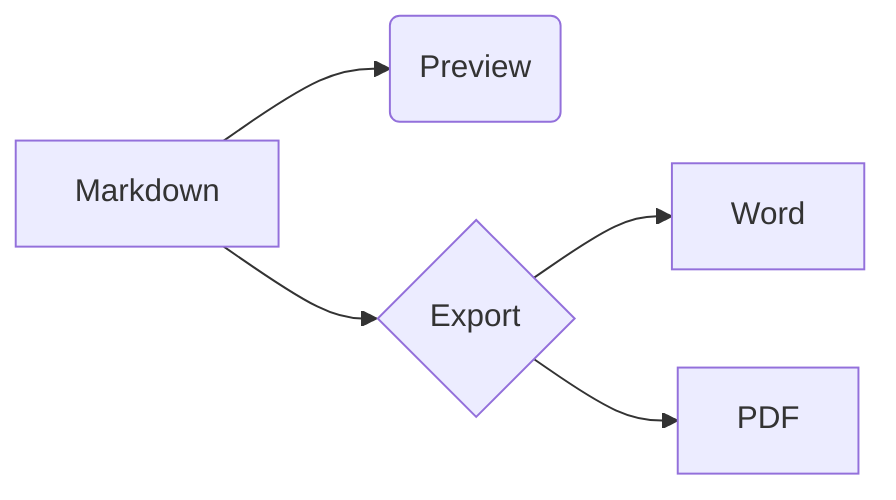

# MarkDownPreview Feature Tour

[TOC]

## Text formatting

**Bold**, *italic*, ~~strikethrough~~, `inline code`, ==highlight==, ++inserted++,
H~2~O, x^2^, and emoji :tada: :rocket:.

Visit [VS Code](https://code.visualstudio.com) or email <mailto:someone@example.com>.

The HTML spec is maintained by the W3C.

*[HTML]: HyperText Markup Language
*[W3C]: World Wide Web Consortium

## Lists

- First item
- Second item
  - Nested item
  - Another nested item
- Third item

1. Step one
2. Step two
3. Step three

- [x] Write the plan
- [ ] Ship the MVP

## GitHub alerts

> [!NOTE]
> Useful information that users should know.

> [!TIP]
> Helpful advice for doing things better.

> [!IMPORTANT]
> Key information users need to know.

> [!WARNING]
> Urgent info that needs immediate attention.

> [!CAUTION]
> Advises about risks or negative outcomes.

## Containers

::: warning Careful
This box uses `::: warning`.
:::

::: details Click to expand
Hidden content.
:::

## Table

| Feature | Preview | Word | PDF |
|:--------|:-------:|:----:|----:|
| Alerts  | ✅ | ✅ | ✅ |
| Mermaid | ✅ | placeholder | ✅ |
| Math    | ✅ | text | ✅ |

## Code

```csharp
public static int Add(int a, int b) => a + b;
```

## Math

Inline math $E = mc^2$ and a block:

$$
\int_0^1 x^2 \, dx = \frac{1}{3}
$$

## Diagram



## Definitions and footnotes

Term
: Definition of the term.

Here is a footnote reference.[^1]

[^1]: And here is the footnote.

---

The end.
